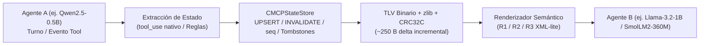

# Cross-Model Context Protocol (CMCP)

**Protocolo independiente de memoria semántica incremental e implementación en C99/Python para sistemas multiagente y modelos LLM heterogéneos.**

> **Estado del Proyecto:** Implementado y evaluado empíricamente (`main`, CMCP 2.2b). CMCP transfiere *estado semántico estructurado* (hechos, entidades, relaciones, restricciones, decisiones y deltas) sobre canales agnósticos al modelo, **no** tensores de KV-cache entre arquitecturas distintas.

---

## 1. Problema y Arquitectura

En pipelines multiagente, reenviar todo el historial (`full_history`) o JSON verboso en cada traspaso incrementa tokens, latencia de prefill y exposición a turnos obsoletos. CMCP separa la **Transferencia Contextual (Nivel A — Funcional)** de la **Transferencia KV/Latente (Nivel B — Incompatible entre arquitecturas)**:

- **Estado tipado y versionado (`representations/state_store.py`):** `CMCPStateStore` gestiona operaciones `StateOp` (`UPSERT`, `INVALIDATE`), idempotencia ante duplicados, rechazo de mensajes fuera de orden, prevención de resurrección mediante tombstones, `checkout_seq()` (`0,078 ms` a 40 turnos) y `compact()`.
- **Formato binario (`representations/binary/`, `core/`):** Framing TLV comprimido con zlib e integridad CRC32C.

---

## 2. Resultados y Limitaciones (CMCP 2.2 / 2.2b, Benchmarks Propios en CPU)

Evaluado en Windows 10 Pro x64, Intel Core i5-13500 (solo CPU, `threads=4`, greedy) sobre `n = 50` escenarios `eval` disjuntos (5 dominios no vistos, 3 reps) con bootstrap agrupado por escenario (IC 95%). Ver [FINAL_RESEARCH_REPORT_V3.md](FINAL_RESEARCH_REPORT_V3.md) y [FINAL_RESEARCH_REPORT_V4.md](FINAL_RESEARCH_REPORT_V4.md).

- **Homogéneo (`Qwen2.5-0.5B -> Qwen2.5-0.5B`):** **Demostrado** (`+0,22 EM`, `-101,3 ms` E2E vs `full_history`, `0,00` tasa obsoleta).
- **Heterogéneo 1 (`Qwen2.5-0.5B -> Llama-3.2-1B`, `R3`):** **Parcialmente demostrado** (`0,61` vs `0,62 EM`, `-257,6 ms` prefill, pero `+442,1 ms` E2E por verborragia de salida y `-0,30` en `relation_recovery`).
- **Heterogéneo 2 (`Qwen2.5-0.5B -> SmolLM2-360M`, `R3`):** **Parcialmente demostrado** (`-396,0 ms` E2E, `+0,15` `relation_recovery`, `0,00` vs `0,28` tasa obsoleta, pero `-0,15 EM`).
- **Extracción desde texto natural no estructurado (`n = 30` diálogos):** `oracle_structured` (`tool_use`) logra precisión/recall `1,000` (`0,039 ms`), mientras que `deterministic_nlp_rules` cae a `0,556` bajo variaciones lingüísticas y `hybrid_gated` (`0,5B`) suma `3.704 ms` sin recuperar hechos omitidos.
- **Transferencia KV / Latente Cross-Arch:** **Refutada** en CMCP 2.1 (`PPL = 493.744`, `EM = 0,0`, [FINAL_RESEARCH_REPORT_V2.md](FINAL_RESEARCH_REPORT_V2.md)).

---

## 3. Integración Opcional con Vect-Link

CMCP es **100% independiente** de Vect-Link. Para escenarios con procesos compatibles que deseen sumar reutilización de KV-cache en memoria compartida, consultar la integración opcional **[VectLink-CMCP](https://github.com/Santirobm/VectLink-CMCP)** junto a **[Vect-Link](https://github.com/Santirobm/Vect-Link)**.

---

## 4. Documentación, Tests y Licencia

- **English README (Primary):** [README.md](README.md)
- **Informes:** [V2](FINAL_RESEARCH_REPORT_V2.md) | [V3](FINAL_RESEARCH_REPORT_V3.md) | [V4](FINAL_RESEARCH_REPORT_V4.md)
- **Tests:** `ctest --test-dir build`, `pytest tests/ -v`, `python experiments/cmcp22b/audit/validate_cmcp22b.py`.
- **Licencia:** Apache License 2.0 — [LICENSE](LICENSE).
