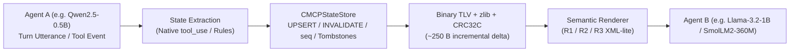

# Cross-Model Context Protocol (CMCP)

**Share conversation context between AI agents using less data and fewer tokens.**

CMCP is a lightweight, incremental context-sharing protocol for AI agents.

Instead of sending the entire conversation history every time an agent hands work to another, CMCP stores information as structured facts, relationships, decisions and constraints. It sends only the information that has changed.

**The result: less data to transfer, fewer input tokens and less outdated information in the context.**

---

## Why CMCP?

When AI agents work together, they often resend large portions of their conversation history.

This creates three problems:
- More tokens to process.
- Longer context preparation (prefill).
- Old or replaced information can remain in the conversation.

CMCP addresses this by maintaining a compact, versioned representation of the shared context.

## What does it do?

1. **Stores relevant information:** facts, entities, relationships, decisions and constraints.
2. **Tracks changes:** new information updates existing state instead of resending everything.
3. **Removes outdated information:** invalidated facts are marked so they are not reused as current information.
4. **Shares compact updates:** only the necessary changes are transferred.
5. **Works across model families:** the receiving model gets structured context that it can interpret, without needing the sender's internal model state.

---

## Problem & Protocol Design

CMCP separates **Context Transfer (Level A — Functional)** from **Internal KV/Latent Transfer (Level B — Incompatible Across Architectures)**:



- **Typed State & Versioning (`representations/state_store.py`):** `CMCPStateStore` manages `StateOp` (`UPSERT`, `INVALIDATE`) keyed by `(fact_id, seq, version, agent_id, digest)`.
- **Consistency & Time-Travel:** Idempotent duplicate handling, out-of-order stale rejection, tombstone resurrection prevention, `lww`/`reject` conflict policies, `checkout_seq(target_seq)` historical reconstruction (`0.078 ms` at 40 turns), and `compact()`.
- **Model-Agnostic Wire Format (`representations/binary/`, `core/`):** C99 library (`cmcp.dll` / `libcmcp.a`) and Python codec with zlib-compressed typed TLV records and CRC32C integrity.
- **Pluggable Rendering (`R1` / `R2` / `R3`):** Separates binary wire state from receiver rendering (`R3` XML-lite `<relations><entities><constraints><decisions><facts>`).

---

## How much can it save?

In our CPU-based experiments, CMCP reduced data transfer and model input tokens compared with sending the full conversation history.

| Experiment | Reduction |
|---|---:|
| Transmitted data (8 turns) | **63.6%** |
| Input tokens, same-model setup (`eval_homo`, R1) | **41.5%** |
| Input tokens, heterogeneous setups (`eval_pair1_r3`, `eval_pair2_r3`) | **28–30%** |
| Cumulative transmitted data (40 turns) | **91.5%** |
| Input tokens in the 40-turn scaling test | **60.2%** |

These are measured results from specific experiments, not guaranteed savings for every model or workload.

## Does it work with different AI models?

CMCP uses a model-independent format for sharing semantic context. It does not transfer the internal memory or KV cache of one model into another.

We tested (`n = 50` disjoint held-out `eval` scenarios × 3 reps, CPU-only):
- `Qwen2.5-0.5B → Qwen2.5-0.5B`
- `Qwen2.5-0.5B → Llama-3.2-1B`
- `Qwen2.5-0.5B → SmolLM2-360M`

The same-model experiment showed the strongest overall results (`+0.22` Exact Match, `-101.3 ms` E2E). Different-model transfers reduced input tokens and prefill latency, but task accuracy and end-to-end speed varied depending on the receiving model:

| Pair & Method | Wire Bytes | Input Tok | Prefill (ms) | E2E (ms) | Exact Match | Rel Rec | Constr Sat | Obs Rate |
|---|---:|---:|---:|---:|---:|---:|---:|---:|
| **Homo (`Qwen2.5-0.5B -> Qwen2.5-0.5B`)** | | | | | | | | |
| `full_history` | 686.4 | 272.9 | 863.7 | 1,926.7 | 0.53 | **0.95** | 0.59 | 0.14 |
| `cmcp_incremental` (`R1`) | **250.0** | **159.7** | **499.2** | **1,825.3** | **0.75** | 0.90 | **0.80** | **0.00** |
| **Hetero 1 (`Qwen2.5-0.5B -> Llama-3.2-1B`)** | | | | | | | | |
| `full_history` | 686.4 | 236.0 | 845.6 | **2,571.0** | **0.62** | **1.00** | **0.85** | 0.02 |
| `cmcp_r3` (`R3` XML-lite) | **250.0** | **164.4** | **588.0** | 3,013.1 | 0.61 | 0.70 | 0.74 | **0.00** |
| **Hetero 2 (`Qwen2.5-0.5B -> SmolLM2-360M`)** | | | | | | | | |
| `full_history` | 686.4 | 303.1 | 888.0 | 1,831.0 | **0.47** | 0.61 | **0.56** | 0.28 |
| `cmcp_r3` (`R3` XML-lite) | **250.0** | **218.1** | **630.8** | **1,435.0** | 0.32 | **0.76** | 0.51 | **0.00** |

---

## Technology

- C99 core and Python implementation.
- Compact binary TLV encoding.
- zlib compression and CRC32C integrity checks.
- Versioned state with `UPSERT` and `INVALIDATE` operations.
- Duplicate detection, stale-update rejection and historical reconstruction.

## Important limitation

CMCP currently works best when context can be captured as structured events, such as native tool calls or application-generated data.

Automatically extracting every relevant fact from unrestricted natural-language conversations remains an unsolved limitation in the current implementation (`deterministic_nlp_rules` dropped to `0.556` state precision/recall on 30 unstructured dialogues, while `0.5B` `hybrid_gated` LLM extraction added `3,704 ms` without recovering missed facts).

CMCP does not provide cross-architecture KV-cache transfer.

---

## Optional Integration with Vect-Link

CMCP has **zero dependency** on Vect-Link and works over standard sockets, pipes, or HTTP. For multi-agent setups that also want shared-memory KV-cache reuse when consecutive workers share identical model weights, see:
- **[Vect-Link](https://github.com/Santirobm/Vect-Link)** — Copy-on-Write KV-cache store and SHM IPC engine.
- **[VectLink-CMCP](https://github.com/Santirobm/VectLink-CMCP)** — optional two-level integration combining CMCP (Level 1) and Vect-Link (Level 2).

---

## Build, Test & Reproduce

```bash
# 1. Build C99 core & tests (Release + ASan/UBSan)
cmake -S . -B build -G Ninja -DCMAKE_BUILD_TYPE=Release
cmake --build build
ctest --test-dir build --output-on-failure

# 2. Run Python tests & CMCP 2.2b audit
pytest tests/ -v
python experiments/cmcp22/audit/validate_cmcp22.py
python experiments/cmcp22b/audit/validate_cmcp22b.py
```

## Research and benchmarks

The project includes reproducible experiments, validation scripts and detailed reports.

- [CMCP 2.1 Research Report](FINAL_RESEARCH_REPORT_V2.md)
- [CMCP 2.2 Research Report](FINAL_RESEARCH_REPORT_V3.md)
- [CMCP 2.2b Validation Report](FINAL_RESEARCH_REPORT_V4.md)
- [Spanish README](README.es.md)

**License:** Apache 2.0 — [LICENSE](LICENSE).
