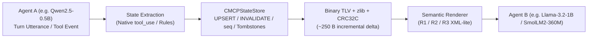

# Cross-Model Context Protocol (CMCP)

**An independent incremental semantic memory protocol and C99/Python implementation for multi-agent systems and heterogeneous LLMs.**

> **Project Status:** Implemented & empirically evaluated (`main`, CMCP 2.2b). CMCP transfers *structured semantic state* (facts, entities, relations, constraints, decisions, and deltas) over model-agnostic text/binary channels—**not** cross-architecture KV-cache tensors.

---

## 1. Problem & Protocol Design

In multi-agent pipelines, resending raw conversation history (`full_history`) or verbose JSON on every handoff increases token count, prefill latency, and exposure to superseded or invalidated turns. CMCP separates **Context Transfer (Level A — Functional)** from **Internal KV/Latent Transfer (Level B — Incompatible Across Architectures)**:



### Core Features
- **Typed State & Versioning (`representations/state_store.py`):** `CMCPStateStore` manages `StateOp` (`UPSERT`, `INVALIDATE`) keyed by `(fact_id, seq, version, agent_id, digest)`.
- **Consistency & Time-Travel:** Idempotent duplicate handling, out-of-order stale rejection, tombstone resurrection prevention, `lww`/`reject` conflict policies, `checkout_seq(target_seq)` historical reconstruction (`0.078 ms` at 40 turns), and `compact()`.
- **Model-Agnostic Wire Format (`representations/binary/`, `core/`):** C99 library (`cmcp.dll` / `libcmcp.a`) and Python codec with zlib-compressed typed TLV records and CRC32C integrity.
- **Pluggable Rendering (`R1` / `R2` / `R3`):** Separates binary wire state from receiver rendering (`R3` XML-lite `<relations><entities><constraints><decisions><facts>`).

---

## 2. Capabilities & Context vs. KV Transfer

| Capability | Status | Scope / Notes |
|---|---|---|
| **Incremental TLV deltas & `CMCPStateStore`** | **Implemented** | `63.6%` wire reduction at 8 turns; `91.5%` cumulative at 40 turns (`311 B`/turn) |
| **Homogeneous Context Transfer (`Qwen2.5-0.5B -> Qwen2.5-0.5B`)** | **Demonstrated** | `+0.22 EM`, `-101.3 ms` E2E speedup vs `full_history` (`n=50`, 3 reps) |
| **Heterogeneous Context Transfer (`Qwen -> Llama` / `SmolLM2`)** | **Partially Demonstrated** | Cuts tokens `41–42%` and prefill `257 ms`; E2E/EM varies by receiver decoding behavior |
| **Cross-Architecture KV / Latent Transfer** | **Refuted (CMCP 2.1)** | Linear/Ridge KV projection failed (`PPL = 493,744`, `EM = 0.0`); `cmcp_check_kv_compat()` rejects mismatches |

---

## 3. Experimental Results (Self-Hosted CPU Benchmarks)

Evaluated on Windows 10 Pro x64, Intel Core i5-13500 (CPU-only, `threads=4`, greedy decoding) across `n = 50` disjoint held-out `eval` scenarios (5 unseen domains) with scenario-clustered bootstrap 95% CIs. See [FINAL_RESEARCH_REPORT_V3.md](FINAL_RESEARCH_REPORT_V3.md) and [FINAL_RESEARCH_REPORT_V4.md](FINAL_RESEARCH_REPORT_V4.md).

### 3.1 Multi-Turn Context Transfer (CMCP 2.2 / 2.2b, `n = 50` × 3 reps)
| Pair & Method | Wire Bytes | Input Tok | Prefill (ms) | E2E (ms) | Exact Match | Rel Rec | Constr Sat | Obs Rate |
|---|---:|---:|---:|---:|---:|---:|---:|---:|
| **Homo (`Qwen2.5-0.5B -> Qwen2.5-0.5B`)** | | | | | | | | |
| `full_history` | 686.4 | 272.9 | 863.7 | 1,926.7 | 0.53 | **0.95** | 0.59 | 0.14 |
| `cmcp_incremental` (`R1`) | **250.0** | **159.7** | **499.2** | **1,825.3** | **0.75** | 0.90 | **0.80** | **0.00** |
| **Hetero 1 (`Qwen2.5-0.5B -> Llama-3.2-1B`)** | | | | | | | | |
| `full_history` | 686.4 | 236.0 | 845.6 | **2,571.0** | **0.62** | **1.00** | **0.85** | 0.02 |
| `cmcp_r3` (`R3` XML-lite) | **250.0** | **164.4** | **588.0** | 3,013.1 | 0.61 | 0.70 | 0.74 | **0.00** |
| **Hetero 2 (`Qwen2.5-0.5B -> SmolLM2-360M`)** | | | | | | | | |
| `full_history` | 686.4 | 303.1 | 888.0 | 1,831.0 | **0.47** | 0.61 | **0.56** | 0.28 |
| `cmcp_r3` (`R3` XML-lite) | **250.0** | **218.1** | **630.8** | **1,435.0** | 0.32 | **0.76** | 0.51 | **0.00** |

### 3.2 Unstructured Natural-Language Extraction Limitations (CMCP 2.2b, `n = 30` dialogues)
- On informal revisions (`"scratch X"`, `"forget the previous limit"`), `full_history` collapsed (`0.000 EM`, `0.800` obsolete rate).
- `oracle_structured` (simulating native `tool_use` schema capture) reached `1.000` state precision/recall (`0.039 ms`, `0.267 EM`, `0.900` constraints).
- CPU `deterministic_nlp_rules` (`0.109 ms`) dropped to `0.556` state precision/recall (`0.133 EM`) under phrasing variation, while `0.5B` `hybrid_gated` LLM fallback added `3,704.0 ms` without recovering missed facts.

---

## 4. Known Limitations

- **Heterogeneous Receiver Sensitivity:** `Llama-3.2-1B` enters greedy repetition loops on Turn 8 structured blocks (`+17.8` output tokens, `+442.1 ms` E2E, `-0.30` relation recovery), whereas `SmolLM2-360M` speeds up E2E (`-396.0 ms`) but loses `-0.15 EM`.
- **Natural-Language Extraction:** Reliable state capture requires native `tool_use`/structured events rather than regex rules or `0.5B` LLM extraction.
- **No Cross-Arch KV Compatibility:** Documented in [FINAL_RESEARCH_REPORT_V2.md](FINAL_RESEARCH_REPORT_V2.md).

---

## 5. Optional Integration with Vect-Link

CMCP has **zero dependency** on Vect-Link and works over standard sockets, pipes, or HTTP. For multi-agent setups that also want shared-memory KV-cache reuse when consecutive workers share identical model weights, see the optional two-level integration repository:
- **[VectLink-CMCP](https://github.com/Santirobm/VectLink-CMCP)** — integrates CMCP (Level 1) with **[Vect-Link](https://github.com/Santirobm/Vect-Link)** (Level 2).
- *Note:* For `~350 B` CMCP deltas alone, Vect-Link SHM adds negligible E2E gain (`0.06%`) over loopback TCP; Vect-Link's value is same-model KV-cache reuse (`-71.0%` prefill, `-22.3%` E2E on `Qwen2.5-0.5B`).

---

## 6. Build, Test & Reproduce

```bash
# 1. Build C99 core & tests (Release + ASan/UBSan)
cmake -S . -B build -G Ninja -DCMAKE_BUILD_TYPE=Release
cmake --build build
ctest --test-dir build --output-on-failure

# 2. Run Python tests & CMCP 2.2b audit
pytest tests/ -v
python experiments/cmcp22/audit/validate_cmcp22.py
python experiments/cmcp22b/audit/validate_cmcp22b.py
```

---

## 7. Documentation & License

- **Research Reports:** [V2 (CMCP 2.1)](FINAL_RESEARCH_REPORT_V2.md) | [V3 (CMCP 2.2)](FINAL_RESEARCH_REPORT_V3.md) | [V4 (CMCP 2.2b)](FINAL_RESEARCH_REPORT_V4.md)
- **Ecosystem:** [Vect-Link](https://github.com/Santirobm/Vect-Link) | [VectLink-CMCP](https://github.com/Santirobm/VectLink-CMCP)
- **Spanish Version:** [README.es.md](README.es.md)
- **License:** Apache License 2.0 — [LICENSE](LICENSE).
